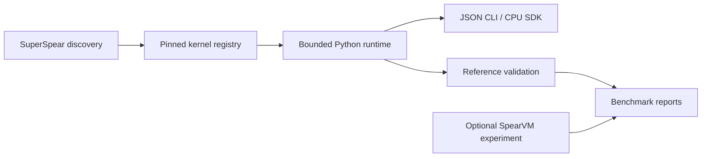

# SPEAR Unified

**Reproducible CPU inference research, symbolic kernels and numerical validation.**

SPEAR Unified is a lightweight research runtime connecting symbolic discovery from [SuperSpear](https://github.com/bahira/superspear) with explicit numerical quality gates, CPU benchmarking and optional native experiments.

> Research prototype — not a production accelerator. Performance claims are limited to measured workloads.

## Capabilities

| Component | Status |
| --- | --- |
| Python runtime | SiLU and GELU, JSON CLI, pinned kernel provenance |
| Symbolic discovery | Bounded, seeded formula search and sample-based proof of concept |
| Numerical validation | Domain checks, independent references, sampled holdout |
| CPU benchmarking | End-to-end latency and explicit baseline comparisons |
| Native integration | Optional SpearVM packed inference experiment on Linux x86-64 AVX2/FMA |

## Quick start

Python 3.10+; Node 22.18+ or 24+ for discovery.

```sh
python -m spear '{"kind":"compute","kernel":"silu","x":1}'
python -m spear '{"kind":"discover","formula":"x*x","seed":42}'
python -m unittest discover -s tests -v
python bench.py
```

## Architecture



The runtime compiles allowlisted JSON operators rather than executing formula text. Kernel provenance is checked using SHA-256. Candidate discovery uses a fixed seed and 257 validation probes, including endpoints and midpoints; it does not automatically promote candidates or certify continuous domains.

## CPU SDK example

```python
from spear.pilot import CPUPilot

pilot = CPUPilot(backend='python-ledger', domain=(-8, 8), max_abs_error=1e-4)
print(pilot.compute('silu', [-2.0, 0.0, 2.0]))
```

## Measured results and limitations

| Experiment | Documented outcome |
| --- | --- |
| Python CPU pilot | Ledger backend 1.40–2.58× slower than direct reference across six scenarios |
| Optional packed native inference | 2.18× faster than unpacked C at batch 1024 on one shared CI runner; smaller batches slower |
| Numerical quality gates | Sampled float32 and domain checks, not formal native parity proofs |
| Historical paper audit | Executable counterexample to a historical stability claim; corrected analysis documented |

```sh
python -m scripts.bench_pilot
python -m scripts.audit_precision --kernel gelu --dtype emulated-f32-step-rounded --abs-tol 0.001
python -m scripts.check_paper_claims
```

No universal speedup is established. Native execution is opt-in, not automatically selected. Browser and LLM adapters are not connected. The native experiment requires a pinned source build because the tested Linux package failed to import.

## Research evidence

- [CPU pilot benchmark](reports/PILOT-CPU-BENCHMARK-2026-11-19.md)
- [Native CPU experiment](reports/SPEARVM-NATIVE-CPU-EXPERIMENT-2026-11-19.md)
- [Numerical quality gates](reports/NUMERIC-QUALITY-GATES-2026-11-19.md)
- [Full-paper verification](reports/FULL-PAPERS-VERIFICATION-2026-11-19.md)
- [Integration audit](reports/SPEARVM-INTEGRATION-AUDIT-2026-11-19.md)
- [Research strategy](reports/FIRST-PRINCIPLES-EDGE-2026-11-19.md)
- [Roadmap](reports/ROADMAP-2026-11-19.md)
- [Archived development notes and detailed commands](reports/README-ARCHIVE.md)

## Related projects

[SuperSpear](https://github.com/bahira/superspear) · [SpearVM](https://github.com/bahira/SpearVM) · [FrankenSpear](https://github.com/bahira/frankenspear)

Imported kernel data is MIT-licensed; see LICENSE.upstream and spear/data/source.json for attribution and provenance.
