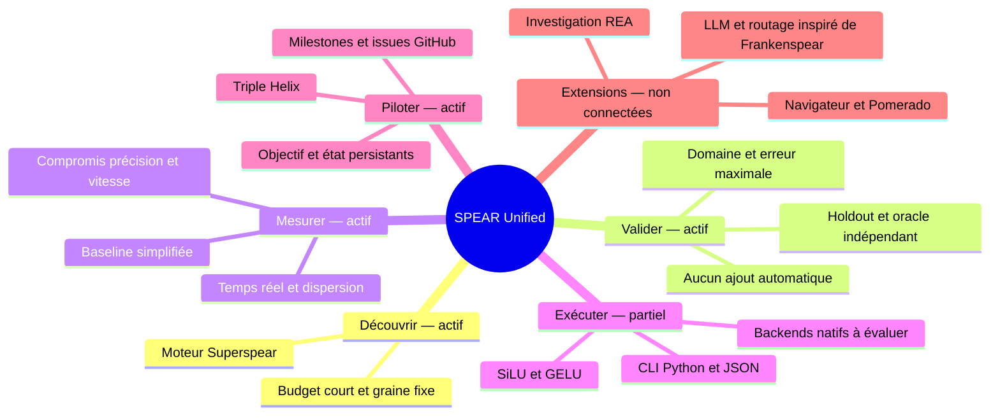

# SPEAR Unified — prototype léger

Socle local sans dépendance externe ni service : Python 3.10+ suffit.

```sh
python -m spear '{"kind":"compute","kernel":"silu","x":1}'
python -m unittest discover -s tests -v
python bench.py
```

## Ce qui fonctionne

- Registre unique de deux enregistrements Superspear (SiLU, GELU), importés à une révision figée et contrôlés par SHA-256 au chargement.
- Compilation des arbres JSON vers un AST Python à opérateurs autorisés ; aucun texte de formule n'est exécuté. Les divisions protégées, clamps et approximation erf suivent la source.
- Routage explicite des tâches structurées ; réponse JSON avec provenance.
- Mesure locale bornée : 1 001 valeurs, 5 passages, comparaison à math.exp/math.erf et mesure des variantes fast, désactivées en production.
- Tests numériques indépendants, entrées non finies, règles numériques, opérateurs inconnus et absence de repli externe silencieux.

## État réel

Les adaptateurs navigateur et LLM renvoient `unavailable` : ils ne sont pas encore connectés. SpearVM n'est pas installé et aucun gain natif n'est revendiqué. Pas de classifieur de langage naturel, de serveur, d'entraînement ou d'appel payant. Aucun dépôt distant modifié.

Les champions sont plus lents que les références mathématiques directes dans ce premier moteur Python. Le but de cette étape est une sémantique traçable et mesurable, pas une promesse d'accélération. Les timings de quelques microsecondes sont bruités et propres à cette VM.

La grille [-8,8] sert de sonde locale ; elle ne certifie pas le domaine de déploiement. Une variante fast ne sera retenue qu'avec un budget d'erreur explicite et un gain end-to-end. Les records upstream restent intacts ; aucune copie manuelle de leur formule dans le runtime.

## Architecture cible et étapes courtes

1. Superspear : source unique des formules et audits (premier import réalisé).
2. Sélecteur de backend : comparer Python de référence, C/WASM et SpearVM, en conservant précision et règles numériques ; choisir seulement sur preuves locales.
3. Frankenspear : reprendre l'idée de routage et les adaptateurs, sans ses copies de formules et sans réutiliser les économies LLM estimées comme mesures réelles.
4. Browser-bot/Pomerado : brancher séparément les tâches asynchrones. Vérifier l'autorisation de chaque chemin d'écriture, y compris le rejeu `browser_run`, avant activation.

Politique d'itération : tests ciblés puis mesure courte, pas de build global ni de gros entraînement. Aucune dépendance lourde sans besoin mesuré.

Sources : https://github.com/bahira/superspear ; https://github.com/bahira/SpearVM ; https://github.com/bahira/frankenspear ; PR https://github.com/bahira/superspear/pull/10.
Les données importées sont sous MIT ; attribution dans LICENSE.upstream et provenance dans spear/data/source.json.

## Découverte connectée

Node 22.18+ ou 24+ exécute directement les deux fichiers TypeScript importés ; aucun npm install ni build global.

```sh
python -m spear '{"kind":"discover","formula":"x*x","seed":42}'
```

Budget par défaut : 64 points, population 32, 8 générations ; limites : 256 points, population 64, 30 générations ; arrêt du processus à 5 secondes et limite de heap V8 à 128 Mio (pas une limite de mémoire totale). La cible est évaluée une seule fois par jeu de données. Une graine fixe reproduit le candidat.

Validation sur 127 points distincts de l'apprentissage. `accepted_on_probe` compare l'erreur maximale à `max_abs_error` (défaut 1e-4) ; ceci ne certifie ni le domaine continu ni une nouvelle loi physique. `status=ok` signifie que la recherche a terminé, pas que la formule est assez précise. `registry_updated=false` : aucun candidat n'est promu automatiquement. Résultats : reports/discovery.json.

Moteur et sémantique de validation upstream ; contrôle indépendant Python ajouté pour le cas x². Recherche limitée aux opérateurs algébriques add/sub/mul/sq/neg ; elle peut échouer sur des cibles simples avec ce petit budget. Les adaptateurs LLM, navigateur et SIMD restent non connectés.

## Objectif et méthode persistants

Voir GOAL.md et AGENTS.md. La skill fournie est disponible dans `.agents/skills/triple-helix/SKILL.md` ; son état local est `.agents/triple_helix_state.json`. Les adaptations automatiques restent désactivées tant que les contradictions du texte ne sont pas clarifiées.

Le projet est publié sur le dépôt privé https://github.com/bahira/spear-unified avec 3 milestones et 6 issues. Le plan source reste dans github-plan.json.

Pour republier les éléments manquants sans dupliquer les titres existants :

```sh
python scripts/publish_github.py bahira/spear-unified
```

Le sprite personnel reste local dans assets/ et est exclu de Git.

## Derniers résultats vérifiés

Voir reports/validation-update.md : domaines individuels, rejet des métriques non finies, contrôle du moteur et coût complet de recherche. Le candidat exp(log(x)) est précis mais perd contre la baseline simplifiée x ; aucune promotion automatique.

Tests du benchmark : `node --disable-warning=MODULE_TYPELESS_PACKAGE_JSON --test tests/benchmark.test.mjs`.

## Carte du projet



Sonde précision/vitesse : `node scripts/pareto-sin.mjs`. Taylor degré 3 sur [-0.1,0.1] atteint une erreur max de 8,33e-8 et ~1,21× sur un premier run JS. Approximations connues, mesures locales, aucune promotion ; voir reports/pareto-sin.md.

## Goal, produit et tableau de bord

- Goal et monétisation envisagée : reports/PRODUCT.md. Premier marché à tester : audit d'optimisation CPU et intégration, puis SDK si les gains applicatifs sont démontrés.
- Sonde native : reports/native-probe.md ; Taylor 7 connu, ~2,51× contre libm sin sur [-1,1], erreur max ~2,73e-6. Ce n'est ni une découverte Superspear ni une mesure incluant les appels Python/C.
- Tableau de bord local : dashboard/index.html, données dans dashboard/status.json. Export : `python scripts/update_dashboard.py`. Pour le consulter : `python -m http.server 8765 --directory dashboard`, puis http://localhost:8765 sur la même machine. La page recharge le fichier toutes les 5 s ; l'agent doit réexporter les nouvelles mesures. Aucune synchronisation live GitHub implémentée.
- Publication Sites non effectuée : les helpers de préparation/publication exigés par la skill ne sont pas présents dans cet environnement. Aucune URL hébergée n'est revendiquée et aucun Site n'a été enregistré.

## Offre et acquisition clients

Voir [rapport.md](rapport.md) : diagnostic proposé à 1 500 € HT, pilote à 3 500 € HT additionnels, intégration à partir de 6 000 € HT ; hypothèses à valider, scénarios de CA, qualification, prospection et prochaines étapes. Aucun client contacté automatiquement.

## Extension de la découverte

Analyse et essais interdomaines : rapport.md, section 11 ; scripts/probe_domains.py et reports/domain-probes.json. Trois approximations de cibles analytiques validées sur grille indépendante avec tolérances illustratives ; aucun gain métier ou loi empirique revendiqué. Import CSV/X-y et adaptation multivariable non implémentés.

Analyse du noyau de priorisation pour les instructions permanentes : [reports/pareto-caveman-prompt.md](reports/pareto-caveman-prompt.md). Recommandation : consigne courte, sans quota fixe ni abandon des exigences ; aucun prompt système de plateforme modifié.

POC de recherche depuis des observations : `node --disable-warning=MODULE_TYPELESS_PACKAGE_JSON scripts/discover_samples.mjs` ; entrée JSON facultative train/validation/test, données synthétiques par défaut. Rapports : reports/samples-discovery.md et .json. Aucun avantage clair contre la baseline quadratique.

Grounded Loop : [reports/grounded-loop-prompt.md](reports/grounded-loop-prompt.md), noyau permanent recommandé et limites de preuve.

## Expérience du pont Python/C

`python scripts/bench_native_bridge.py` compile temporairement les fonctions C déjà présentes et mesure leur appel depuis Python sur des buffers `array('d')`, avec validation et allocation incluses. Aucun composant installé ni backend activé. Sur cette VM, le grand lot est plus rapide que Python, le lot d’un élément est plus lent. Construction/conversion initiale du buffer et démarrage CLI exclus : voir [reports/native-bridge-20261105.md](reports/native-bridge-20261105.md) pour précision, deux essais indépendants et limites. Linux et compilateur C déjà présent requis.

Le coût des conversions est mesuré séparément par `python scripts/bench_native_conversion.py` : listes et JSON avec contrôles, conversions et sérialisation inclus. Sur les deux essais du 8 novembre, aucun gain natif robuste n’est établi pour ces chemins ; le runtime reste inchangé. Voir [reports/native-conversion-20261108.md](reports/native-conversion-20261108.md). Les rapports sur buffers préconstruits restent des cas distincts.

Le repli hors domaine est sondé par `python scripts/bench_native_mixed.py` (buffers préexistants, 0/50/100 % hors [-1,1]). Les comptes et erreurs sont contrôlés : 100 % hors domaine signifie zéro approximation. Les variations de temps ne doivent pas être attribuées à Taylor dans ce cas. Voir [reports/native-mixed-20261111.md](reports/native-mixed-20261111.md). Runtime inchangé, données synthétiques uniquement.

Qualification numérique supplémentaire du pont expérimental : [sondes aléatoires, bornes et repli extrême](reports/native-precision-20261113.md). Exécution courte : `python scripts/check_native_precision.py`. Validation finie sur cette plateforme ; aucun changement du runtime.
