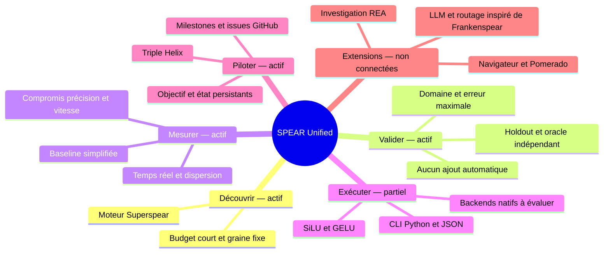

[Session research and native integration progress, 2026-11-19](reports/SESSION-PROGRESS-2026-11-19.md): 4 Unified PRs, 1 SpearVM packaging PR, real CI evidence and remaining blockers.


## Research-site correction and progress

[20-point paper verification checkpoint](reports/PAPER-RESEARCH-PROGRESS-2026-11-19.md) and [public-site erratum proposal](reports/RESEARCH-SITE-ERRATUM-PROPOSAL-2026-11-19.md) document a counterexample to the published embedded controller's stability argument and a corrected 84 MHz cycle calculation. The original public research-site file is **not** modified (GitHub branch write HTTP 403).

## Opt-in SpearVM packed CPU inference experiment

Experimental integration of [SpearVM](https://github.com/bahira/SpearVM) without copying its native runtime or imposing base dependencies. `spear.spearvm.SpearVMPackedGELU` constructs a packed f32 weights+bias `matmul + GELU` kernel on explicit request only, Linux x86_64 AVX2/FMA, no silent fallback; full independent libm comparison can be enabled per call. Does **not** replace scalar `CPUPilot`.

```sh
python -m pip install 'numpy>=2,<3' 'spur-math==0.5.3'
python -m scripts.bench_spearvm
```

See the [optional benchmark](scripts/bench_spearvm.py), [experiment workflow](.github/workflows/spearvm-experiment.yml) and [measured native CPU report](reports/SPEARVM-NATIVE-CPU-EXPERIMENT-2026-11-19.md). On one shared CI runner, batch 1024 was 2.18× faster than unpacked C, while batches 1/32/256 were slower; no general or commercial gain is established. PyPI Linux 0.5.3 failed on import, so the experiment builds the pinned source.

## Numerical quality gates

[Offline float32/domain/composition audit](reports/NUMERIC-QUALITY-GATES-2026-11-19.md): use `python -m scripts.audit_precision --kernel gelu --dtype emulated-f32-step-rounded --abs-tol 0.001`. These are sampled checks, **not** native C/WASM parity proofs or automatic backend promotion.

## Full-paper source audit and executable claim check

The complete research-site Markdown manuscripts were recovered at a pinned source commit. The [full-paper verification report](reports/FULL-PAPERS-VERIFICATION-2026-11-19.md) includes corrected pendulum Lyapunov algebra and an executable counterexample (`python -m scripts.check_paper_claims`). This exposes a **mathematical error in a historical stability claim**; it is not an independent replication of all nine papers or hardware performance. No experimental controller is deployed.

# SPEAR Unified — prototype léger

Socle local sans dépendance externe ni service : Python 3.10+ suffit.

```sh
python -m spear '{"kind":"compute","kernel":"silu","x":1}'
python -m unittest discover -s tests -v
python bench.py
```

## Strategic direction: seek a measurable asymmetric edge

**New north star:** reduce the full end-to-end cost of a *real repeated CPU workload*, not merely approximate SiLU/GELU. The current Python ledger is 1.40–2.58× slower than the direct reference in matched pilot CI measurements. The highest-priority hypothesis is **fusion of workload-specific vector operations** to eliminate intermediate allocations, conversion and repeated dispatch. Compare against the strongest optimized baseline; only then test approximation. No acceleration or commercial moat has yet been demonstrated.

Read the [first-principles strategy and go/no-go gates](reports/FIRST-PRINCIPLES-EDGE-2026-11-19.md) and [updated project goal](GOAL.md).

## Audit des anciens papiers SPEAR

[Audit de 20 vérifications documentaires](reports/LEGACY-PAPER-20-CHECK-AUDIT-2026-11-19.md) : manuscrit original, brouillon corrigé, coût théorique vs mesuré, précision f32, compositions hors domaine, négatifs PyTorch/ORT. Ces vérifications portent sur les **sources historiques** et ne constituent pas 20 nouveaux benchmarks.

## SpearVM — réutilisation sélective

Audit source de [bahira/SpearVM](https://github.com/bahira/SpearVM) : [rapport d'intégration](reports/SPEARVM-INTEGRATION-AUDIT-2026-11-19.md). Le candidat prioritaire n'est pas le calcul scalaire mais l'inférence répétée de petits MLP CPU avec poids pré-empaquetés (`PackedNT`, `PackedMLP`) et fusion `matmul + bias + GELU`. SpearVM reste moins rapide qu'OpenBLAS en GEMM pur et que PyTorch/ONNX sur l'encodeur testé. Ses benchmarks positifs de serving digits demandent une reproduction indépendante. Pas d'intégration native automatique ni de dépendance SpearVM imposée.

## État vérifié — 19 novembre 2026

**Statut : prototype de recherche/validation CPU, pas accélérateur universel prêt pour la production.**

| Composant | État | Preuve / limite |
| --- | --- | --- |
| Runtime Python SiLU/GELU et CLI JSON | Opérationnel | Registre figé, compilation AST bornée et tests Python |
| Découverte Superspear depuis une formule | Opérationnelle sous Node 22.18+/24+ | Recherche bornée, graine fixe, 257 points de sonde avec bornes et milieux ; pas de garantie sur le continu |
| Découverte depuis des échantillons x/y | POC opérationnel | Script Node, provenance SHA-256 des fichiers fournis, contrôles du moteur avant import ; pas de loi scientifique prouvée |
| Benchmarks Python | Opérationnels | Mesure end-to-end JSON/routage et comparaison de référence, ordre AB/BA alterné ; pas de gain applicatif prouvé |
| Expériences C/ctypes | Disponibles, **non activées** | Sondes de conversion, domaine, précision et fallback ; pas de sélection native automatique |
| CI GitHub Actions | Active | Tests Python 3.10/3.12, Node, smoke-test de découverte d'échantillons et contrôle de précision native Linux |
| Adaptateurs navigateur, LLM, SpearVM | Non connectés | Aucune automatisation distante ou accélération SpearVM revendiquée |

### Démarrage et validation

Depuis la racine du dépôt, avec Python 3.10+ et Node 22.18+ ou 24+ pour la découverte :

```sh
python -m spear '{"kind":"compute","kernel":"silu","x":1}'
python -m spear '{"kind":"discover","formula":"x*x","seed":42}'
python -m unittest discover -s tests -v
node --disable-warning=MODULE_TYPELESS_PACKAGE_JSON --test tests/benchmark.test.mjs
node --disable-warning=MODULE_TYPELESS_PACKAGE_JSON scripts/discover_samples.mjs
python scripts/bench_end_to_end.py --samples 1001 --repeats 7 --warmups 2 --output reports/local-end-to-end.json
```

La dernière commande écrit un fichier local ; les temps dépendent du matériel et ne constituent pas des résultats universels. Le rapport contient des ratios **indicatifs**, pas une comparaison de deux implémentations fonctionnellement identiques.

Expériences natives **optionnelles sur Linux avec un compilateur C** :

```sh
python scripts/check_native_precision.py
python -m unittest tests.test_native_bridge tests.test_native_conversion -v
```

Les expériences natives compilent des bibliothèques temporaires. Elles ne changent pas le chemin de calcul utilisé par la CLI.

### Pilote SDK CPU explicite (expérimental)

```python
from spear.pilot import CPUPilot
xs = [-2.0, 0.0, 2.0]
baseline = CPUPilot(backend='reference', domain=(-8, 8))
candidate = CPUPilot(backend='python-ledger', domain=(-8, 8), max_abs_error=1e-4)
print(baseline.compute('silu', xs))
print(candidate.compute('silu', xs))
```

Les backends `reference` et `python-ledger` sont explicites : pas d'auto-sélection, de backend C/WASM activé ou de fallback silencieux. Les entrées sont limitées à 65 536 valeurs numériques finies et à un domaine configuré ; l'erreur est vérifiée contre la référence pour chaque sortie. La tolérance est facultative, mais si elle est renseignée un dépassement provoque une exception.

Comparaison de latence sur le **même contrat d'API** (tailles 1, 64 et 4096) :

```sh
python -m scripts.bench_pilot
```

Le benchmark mesure le coût complet du pilote, y compris validation des entrées, sortie et calcul d'erreur, et non uniquement la fonction mathématique. **Résultat CI observé : le backend ledger est 1,40× à 2,58× plus lent que la référence** sur les six scénarios mesurés (lots 1/64/4096). Voir [rapport CPU pilote](reports/PILOT-CPU-BENCHMARK-2026-11-19.md). Les timings restent dépendants du matériel et ne constituent pas une promesse de vitesse.

### Travail restant, par priorité

1. Consolider les améliorations de découverte depuis les échantillons encore dans la PR #10, en évitant de réintroduire les conflits documentaires.
2. Comparer les calculs natifs et Python sur des tailles de lots représentatives, avec coûts de conversion, erreurs, distribution des domaines et matériel documentés.
3. Définir des seuils d'acceptation mesurables (précision, latence, coût, fallback), puis seulement envisager un backend optionnel.
4. Construire un cas d'usage SDK/pilote avant toute promesse commerciale d'accélération.
5. Connecter les adaptateurs navigateur/LLM uniquement pour un besoin concret et autorisé.

Rapport d'intégration et protocole d'expérimentation : [reports/INTEGRATION-AND-EXPERIMENT-2026-11-19.md](reports/INTEGRATION-AND-EXPERIMENT-2026-11-19.md).

Suivi : [issues](https://github.com/bahira/spear-unified/issues), [pull requests](https://github.com/bahira/spear-unified/pulls), [roadmap](reports/ROADMAP-2026-11-19.md). Les PR historiques [#10](https://github.com/bahira/spear-unified/pull/10) et [#11](https://github.com/bahira/spear-unified/pull/11) ne sont **pas** fusionnées intégralement ; des éléments ont été repris dans les PR #20, #21 et #23.

## Ce qui fonctionne

- Registre unique de deux enregistrements Superspear (SiLU, GELU), importés à une révision figée et contrôlés par SHA-256 au chargement.
- Compilation des arbres JSON vers un AST Python à opérateurs autorisés ; aucun texte de formule n'est exécuté. Les divisions protégées, clamps et approximation erf suivent la source.
- Routage explicite des tâches structurées ; réponse JSON avec provenance.
- Mesure locale bornée : 1 001 valeurs, 5 passages, comparaison à math.exp/math.erf et mesure des variantes fast, désactivées en production.
- Tests numériques indépendants, entrées non finies, règles numériques, opérateurs inconnus et absence de repli externe silencieux.

## État réel

Les adaptateurs navigateur et LLM renvoient `unavailable` : ils ne sont pas encore connectés. SpearVM n'est pas installé et aucun gain natif n'est revendiqué. Pas de classifieur de langage naturel, de serveur, d'entraînement ou d'appel payant. Le dépôt privé GitHub est utilisé pour les modifications et validations.

Les champions sont plus lents que les références mathématiques directes dans ce premier moteur Python. Le but de cette étape est une sémantique traçable et mesurable, pas une promesse d'accélération. Les timings de quelques microsecondes sont bruités et propres à cette VM.

La grille [-8,8] sert de sonde locale ; elle ne certifie pas le domaine de déploiement. Une variante fast ne sera retenue qu'avec un budget d'erreur explicite et un gain end-to-end. Les records upstream restent intacts ; aucune copie manuelle de leur formule dans le runtime.

## Architecture cible et étapes courtes

1. Superspear : source unique des formules et audits (premier import réalisé).
2. Sélecteur de backend : comparer Python de référence, C/WASM et SpearVM, en conservant précision et règles numériques ; choisir seulement sur preuves locales.
3. Frankenspear : reprendre l'idée de routage et les adaptateurs, sans ses copies de formules et sans réutiliser les économies LLM estimées comme mesures réelles.
4. Browser-bot/Pomerado : brancher séparément les tâches asynchrones. Vérifier l'autorisation de chaque chemin d'écriture, y compris le rejeu `browser_run`, avant activation.

Politique d'itération : tests ciblés puis mesure courte, pas de build global ni de gros entraînement. Aucune dépendance lourde sans besoin mesuré.

Sources : https://github.com/bahira/superspear ; https://github.com/bahira/SpearVM ; https://github.com/bahira/frankenspear ; PR https://github.com/bahira/superspear/pull/10.
Les données importées sont sous MIT ; attribution dans LICENSE.upstream et provenance dans spear/data/source.json.

## Découverte connectée

Node 22.18+ ou 24+ exécute directement les deux fichiers TypeScript importés ; aucun npm install ni build global.

```sh
python -m spear '{"kind":"discover","formula":"x*x","seed":42}'
```

Budget par défaut : 64 points, population 32, 8 générations ; limites : 256 points, population 64, 30 générations ; arrêt du processus à 5 secondes et limite de heap V8 à 128 Mio (pas une limite de mémoire totale). La cible est évaluée une seule fois par jeu de données. Une graine fixe reproduit le candidat.

Validation sur 257 évaluations : les 127 points intérieurs, les deux bornes exactes et les 128 milieux entre points de base, hors apprentissage. Le rapport indique `holdout.endpoints_included=true`, `midpoints_included=true`, `base_rows=129` et `midpoint_rows=128`. Ce raffinement fixe ne certifie pas le domaine continu. `accepted_on_probe` compare l'erreur maximale à `max_abs_error` (défaut 1e-4) ; ceci ne certifie ni le domaine continu ni une nouvelle loi physique. `status=ok` signifie que la recherche a terminé, pas que la formule est assez précise. `registry_updated=false` : aucun candidat n'est promu automatiquement. Résultats : reports/discovery.json.

Moteur et sémantique de validation upstream ; contrôle indépendant Python ajouté pour le cas x². Recherche limitée aux opérateurs algébriques add/sub/mul/sq/neg ; elle peut échouer sur des cibles simples avec ce petit budget. Les adaptateurs LLM, navigateur et SIMD restent non connectés.

## Objectif et méthode persistants

Voir GOAL.md et AGENTS.md. La skill fournie est disponible dans `.agents/skills/triple-helix/SKILL.md` ; son état local est `.agents/triple_helix_state.json`. Les adaptations automatiques restent désactivées tant que les contradictions du texte ne sont pas clarifiées.

Le projet est publié sur le dépôt privé https://github.com/bahira/spear-unified ; consulter GitHub pour le nombre actuel d'issues et de milestones. Le plan source initial reste dans github-plan.json.

Pour republier les éléments manquants sans dupliquer les titres existants :

```sh
python scripts/publish_github.py bahira/spear-unified
```

Le sprite personnel reste local dans assets/ et est exclu de Git.

## Derniers résultats vérifiés

Voir reports/validation-update.md : domaines individuels, rejet des métriques non finies, contrôle du moteur et coût complet de recherche. Le candidat exp(log(x)) est précis mais perd contre la baseline simplifiée x ; aucune promotion automatique.

Tests du benchmark : `node --disable-warning=MODULE_TYPELESS_PACKAGE_JSON --test tests/benchmark.test.mjs`.

## Carte du projet



Sonde précision/vitesse : `node scripts/pareto-sin.mjs`. Taylor degré 3 sur [-0.1,0.1] atteint une erreur max de 8,33e-8 et ~1,21× sur un premier run JS. Approximations connues, mesures locales, aucune promotion ; voir reports/pareto-sin.md.

## Goal, produit et tableau de bord

- Goal et monétisation envisagée : reports/PRODUCT.md. Premier marché à tester : audit d'optimisation CPU et intégration, puis SDK si les gains applicatifs sont démontrés.
- Sonde native : reports/native-probe.md ; Taylor 7 connu, ~2,51× contre libm sin sur [-1,1], erreur max ~2,73e-6. Ce n'est ni une découverte Superspear ni une mesure incluant les appels Python/C.
- Tableau de bord local : dashboard/index.html, données dans dashboard/status.json. Export : `python scripts/update_dashboard.py`. Pour le consulter : `python -m http.server 8765 --directory dashboard`, puis http://localhost:8765 sur la même machine. La page recharge le fichier toutes les 5 s ; l'agent doit réexporter les nouvelles mesures. Aucune synchronisation live GitHub implémentée.
- Publication Sites non effectuée : les helpers de préparation/publication exigés par la skill ne sont pas présents dans cet environnement. Aucune URL hébergée n'est revendiquée et aucun Site n'a été enregistré.

## Offre et acquisition clients

Voir [rapport.md](rapport.md) : diagnostic proposé à 1 500 € HT, pilote à 3 500 € HT additionnels, intégration à partir de 6 000 € HT ; hypothèses à valider, scénarios de CA, qualification, prospection et prochaines étapes. Aucun client contacté automatiquement.

## Extension de la découverte

Analyse et essais interdomaines : rapport.md, section 11 ; scripts/probe_domains.py et reports/domain-probes.json. Trois approximations de cibles analytiques validées sur grille indépendante avec tolérances illustratives ; aucun gain métier ou loi empirique revendiqué. Import CSV/X-y et adaptation multivariable non implémentés.

Analyse du noyau de priorisation pour les instructions permanentes : [reports/pareto-caveman-prompt.md](reports/pareto-caveman-prompt.md). Recommandation : consigne courte, sans quota fixe ni abandon des exigences ; aucun prompt système de plateforme modifié.

POC de recherche depuis des observations : `node --disable-warning=MODULE_TYPELESS_PACKAGE_JSON scripts/discover_samples.mjs` ; entrée JSON facultative train/validation/test, données synthétiques par défaut. Rapports : reports/samples-discovery.md et .json. Aucun avantage clair contre la baseline quadratique.

Grounded Loop : [reports/grounded-loop-prompt.md](reports/grounded-loop-prompt.md), noyau permanent recommandé et limites de preuve.

Correction du contrôle aux bornes et exemple de faux positif rejeté : [reports/discovery-endpoints-20261102.md](reports/discovery-endpoints-20261102.md). Les rapports antérieurs restent des instantanés de leur protocole d’origine.

Raffinement entre points de validation : [reports/discovery-midpoints-20261109.md](reports/discovery-midpoints-20261109.md), contre-exemple synthétique de pic étroit, test avant/après et mesure du coût. Les rapports précédents restent des instantanés de leurs grilles respectives.
